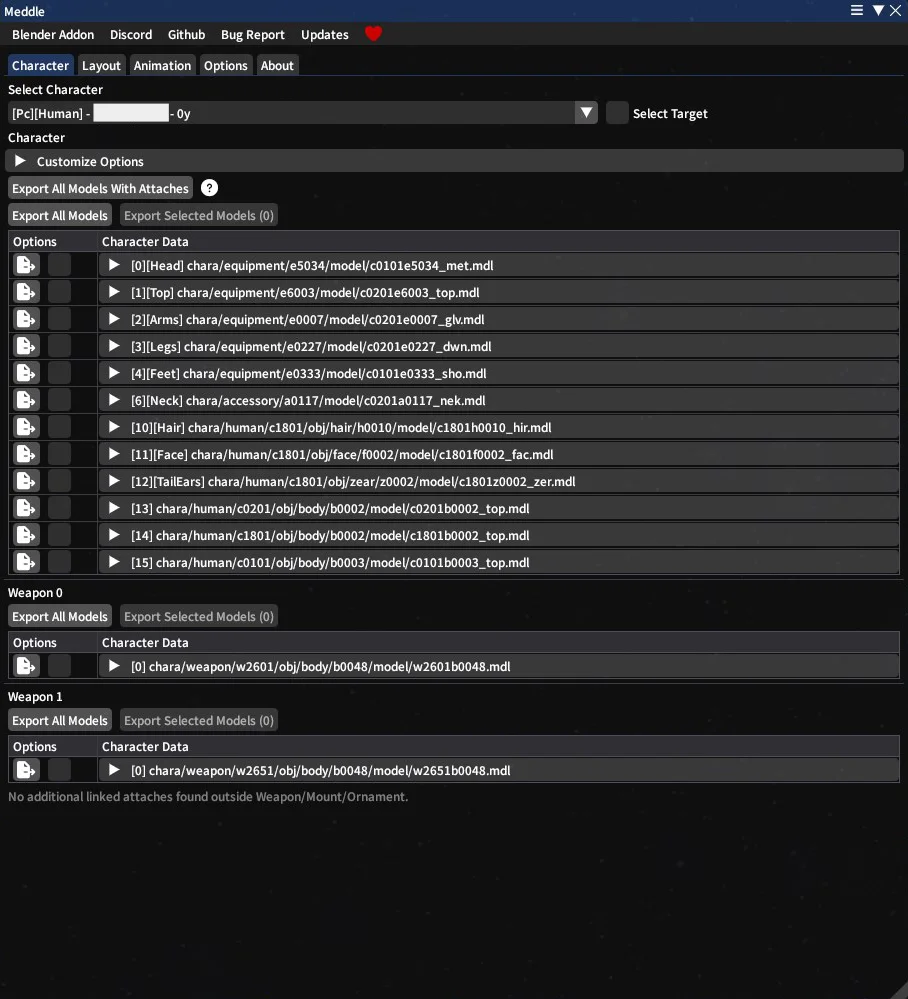
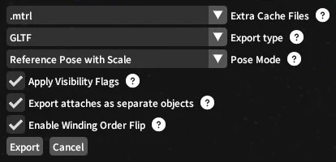
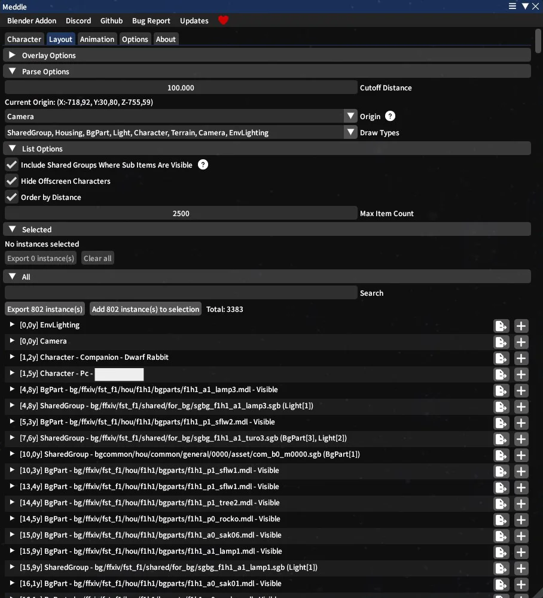
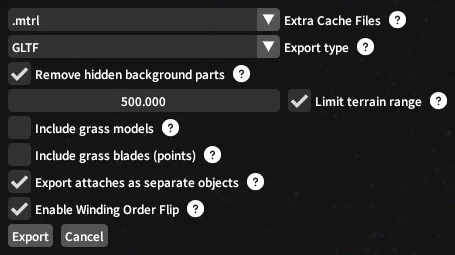
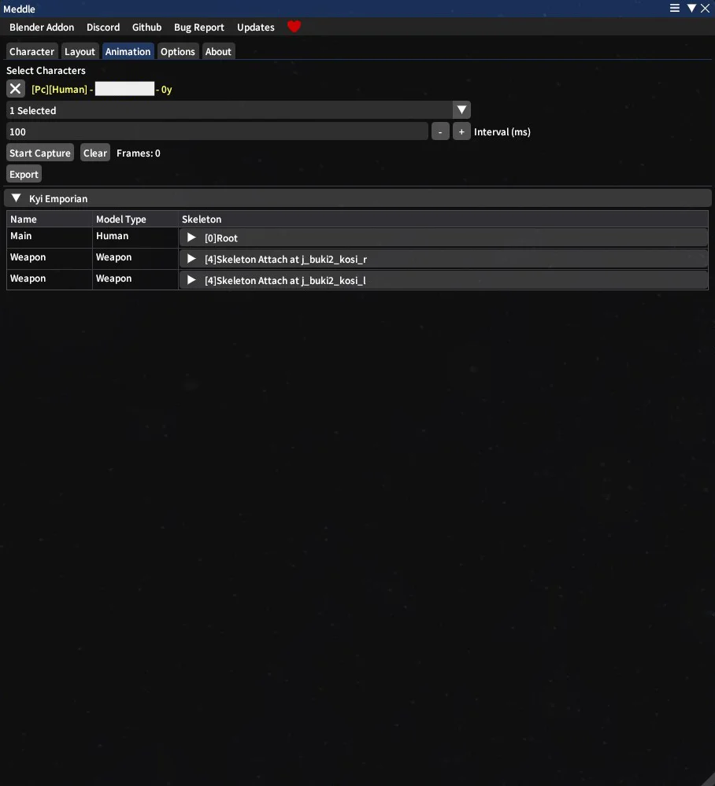

# Exporting with Meddle
{: .fs-9 .no_toc }
This tutorial covers how to export things with Meddle, be they Character or Environment.
{: .fs-6 .fw-300 }

- TOC
{:toc} 

---

## Before Starting
This tutorial will not cover *installing* Meddle. If you need to do that, visit the [Meddle GitHub page](https://github.com/PassiveModding/Meddle) for instructions.

## Characters

Characters are the simplest to export, and are handled from the default "Character" tab! Simply select the desired character in the drop-down menu at the top to get started. 
You can also tick the "Select Target" box and whoever you have targeted in-game will become selected in Meddle.
   
If the selected character has "attaches" (such as weapons or fashion accessories), you're given the option to "Export All Models With Attaches". This exports everything about the character. 
Alternatively, you can export attaches individually. If you don't want attaches, just click "Export All Models" instead.

Once you've clicked either of those buttons, you will be greeted with this menu. 
Hovering over any of the (?) will tell you more about what each option does, but these are the important ones:

<ul>
<li><b>Extra Cache Files</b> This can export some files directly as the game stores them, rather than converting to more universal format model/texture formats like PNG and GLTF. Usually this isn't necessary, but some Blender addons make use of them! <a href="#ffgear">FFGear</a> for example uses .mtrl files to let you dye your gear after it's already been exported. It's worth checking if any of the tools you plan on using want a specific file from here or not.</li>
<li><b>Export type</b> This should be set to GLTF, it is what we can then import into Blender.</li>
<li><b>Pose Mode</b> This determines how the character is posed when exported. Your options are "Reference Pose", "Reference Pose with Scale" and "Pose".</li>
<ul>
<li><b>Reference Pose</b> will save the character in an A-pose, essentially not being posed at all.</li>
<li><b>Reference Pose with Scale</b> will save the character in an A-pose, except it will also include any scaling the character has like their height, tail length and bust size. It will also export any Customize+ scaling, but NOT Customize+ position or rotation edits.</li>
<li><b>Pose</b> will save the character exactly as they are stood in-game on your screen.</li>
</ul>

If you don't have any Customize+ modifications to your character, or your Customize+ only affects scale and no rotation/position, just pick "Reference Pose with Scale" and export that. 
If you DO have Customize+ modifications with rotation/position, disable Customize+ entirely, and copy the C+ profile you use to your clipboard. Then export using "Reference Pose with Scale". The C+ text you copied can be used in AetherBlend to apply your modifications later, so save that somewhere along with your export.

<li><b>Other Checkboxes</b> They're good, and you should have them checked. Hover over the (?) if you want to know more about what they do.</li>
</ul>

## Layout

Layout is useful for exporting Environments! 
In the dropdown "Parse Options", you can select the range in which you'll be exporting things. Once something is in range, you should see a little dot show up below it, which you can hover over to see some information about what it is. If you don't see any, try increasing your range and make sure that your overlay is on, which you can control in the "Overlay Options" dropdown at the top.
   
You can also select the origin for the objects, which have different pros and cons (explained when hovering the (?) icon), as well as the different types of things you want to consider. For example, you can disable "Character" if you don't want characters to come with. 
If you want to export an environment, all the other ones are good to leave on.
   
At the bottom of the tab you should see a big list of all the things that are in range and match your selected Draw Types. You can either Export them directly from there, or add them to your selection. Then you can go somewhere else, add some more stuff, and add that to your selection to, and export everything together.

Once you've hit export, you will be greeted with this menu:
   
Like before, the settings are explained by hovering the (?) icons, and a lot of it is the same as with Characters or very self-explanatory. The one good thing to note is that you have a separate radius for Terrain objects here. Terrain is the underlying ground of the world, most often dirt, stone, etc. Because those chunks are pretty big in comparison to other items, and their origins can be pretty far away, it gets its own slider here. 
If you want all the terrain, just uncheck that.

{: .warning }
> Environments consist of MANY objects, and the only reason your computer can run comfortably with all that is because the game engine only loads what you're close to / can see. Other things have reduced texture and model quality, or are removed entirely.  
> Blender does NOT do that. If you export an entire environment, expect your computer to chug really badly when you put it in Blender. It's often best to only export smaller sections of the map. You can of course export it all and organize things into collections per area, so you can hide things when the camera doesn't see them, but it can be a lot of work.

<!-- ## Animation

The Animation tab lets you export animations as you see them! 
You select some number of characters, or just yourself, record for a bit, and all that motion will be saved!
   
The "Interval" is how often the animation will be sampled. An interval of 100ms means 10 samples per second, because there are 1000 ms in a second. 
If you want animation sampled at 60fps, set the interval to 1000/60 = 16,66

 -->
<!-- This part is commented out because I personally don't use the Animation export much at all, and I don't have the brain-juice to test that what's written here is accurate right now. If you want to test and confirm and potentially re-write this, feel free! -->